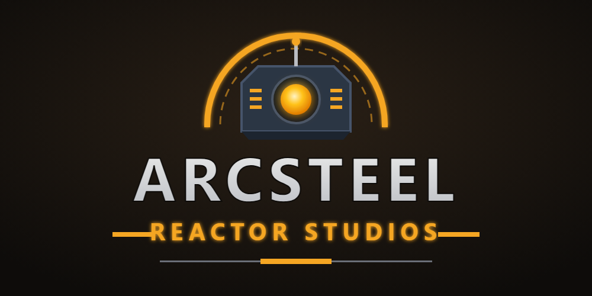

### Indie game studio building fast, loud, cross-platform mech games.

---

## 👋 About the studio

**Arcsteel Reactor Studios** is an independent game studio that makes action games about one thing: **mechs**.
Every mech we make gets its own weapons, its own dash and its own super, so no two play the same.
We build in the open, ship updates often and listen to the players in our Discord.

## 🎮 Ironvale

**Ironvale** is our free top-down mech arena brawler. Pick a mech, take it into the arena and fight bots or other players in short, fast matches.

- ⚔️ **Arena battles:** free-for-all, duels and team fights against bots or real players
- 🤖 **Lots of unique mechs:** every one has its own attacks, dash and super
- 🌐 **Cross-play online:** Windows, Android and browser players in the same matches
- 🏆 **Ranked tiers, PvE missions and progression:** unlock, upgrade and climb
- 🔄 **Always growing:** new mechs, modes and events with every update

| Platform | Where |
|---|---|
| 🌐 Browser | [Play now](https://ironvale.gmicrosystem.com/play/) · [CrazyGames](https://www.crazygames.com/game/ironvale) |
| 🪟 Windows | [Download](https://ironvale.gmicrosystem.com/) · [itch.io](https://arcsteel-reactor-studios.itch.io/ironvale) |
| 🤖 Android | [Download](https://ironvale.gmicrosystem.com/) |

➡️ Releases and patch notes: [arcsteelreactorstudios/Ironvale](https://github.com/arcsteelreactorstudios/Ironvale)

## 🎬 Circuit Life: The Movie

A full one-hour story movie made entirely inside Ironvale. Bastion is an ordinary accountant mech who ends up in the Circuit League against Ragnarok, the champion who has never lost. Every fight is real in-game combat.
Watch it on [YouTube](https://www.youtube.com/@ArcsteelReactorStudios).

## 🛠️ How we build

- **Unity 6** with the Universal Render Pipeline, tuned to run on phones and in the browser
- **Netcode for GameObjects + Unity Relay** for online cross-play
- One codebase, three platforms: Windows, Android and WebGL

## 💬 Join us

- **Discord:** [discord.gg/e2WQQWfSRm](https://discord.gg/e2WQQWfSRm): squad up, report bugs and suggest mechs
- **YouTube:** [@ArcsteelReactorStudios](https://www.youtube.com/@ArcsteelReactorStudios): trailers, mech reveals and Shorts
- **Website:** [ironvale.gmicrosystem.com](https://ironvale.gmicrosystem.com/)

**Arcsteel Reactor Studios. Built in the reactor. Forged in steel.** ⚙️🔥

